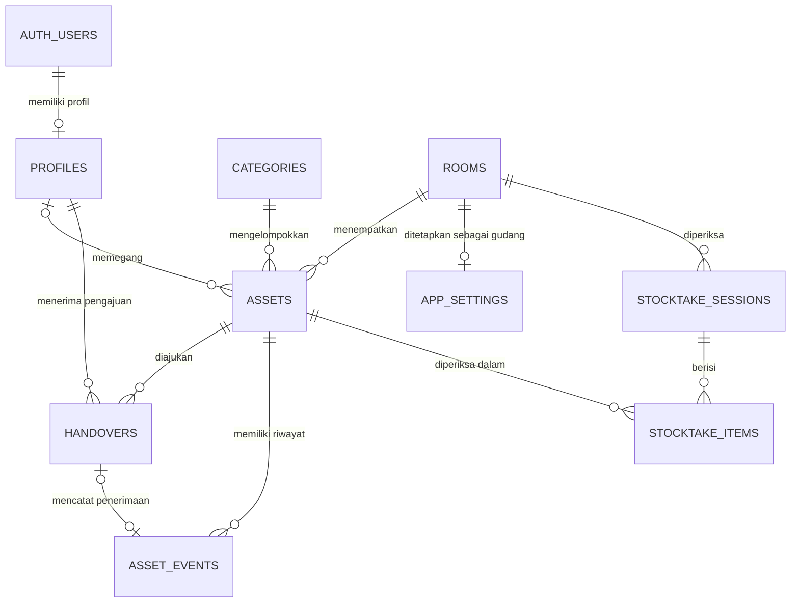

# EgaAsset · ERD MVP

Model PostgreSQL untuk [EgaAsset-PRD.md](EgaAsset-PRD.md). Nama tabel dan kolom di bawah menjadi acuan migrasi. Diagram menampilkan relasi utama. Kolom audit dan relasi tambahan dirinci setelah diagram.

## Kamus data

ID menggunakan UUID kecuali singleton pengaturan. PK dan kolom lain wajib terisi kecuali ditandai opsional. Waktu menggunakan `timestamptz`. FK historis menggunakan pembatasan penghapusan dan data master yang sudah direferensikan dinonaktifkan saat tidak dipakai.

| Tabel | Kolom dan tipe | Aturan |
|---|---|---|
| `auth.users` | `id` UUID PK | Dikelola Supabase Auth. Menyimpan identitas internal dan kredensial. |
| `profiles` | `id` PK/FK ke `auth.users`, `username` text, `display_name` text, `role` enum, `is_active` boolean, `must_change_password` boolean, `session_valid_after` timestamp opsional, `created_at` | Username disimpan dalam bentuk normalisasi dan unik. Akun yang diaktifkan wajib punya profil. Maksimal satu Admin aktif untuk MVP. Role dan flag akun hanya berubah melalui alur administrasi yang berwenang. |
| `rooms` | `id` PK, `name` text, `is_active` boolean | Nama unik setelah normalisasi. Ruangan Gudang dan ruangan dengan aset aktif atau sesi terbuka harus tetap aktif. |
| `categories` | `id` PK, `name` text, `is_active` boolean | Nama unik setelah normalisasi. Kategori nonaktif tetap tampil di data lama dan tidak tersedia untuk pilihan baru. |
| `app_settings` | `id` smallint PK bernilai 1, `warehouse_room_id` FK ke `rooms` | Satu baris pengaturan. Gudang harus aktif. Siapkan Gudang dan baris pengaturan saat bootstrap. |
| `assets` | `id` PK, `code` text, `name` text, `category_id` FK, `room_id` FK, `holder_id` FK ke `profiles` opsional, `condition` enum, `status` enum, `serial_number` text opsional, `brand_model` text opsional, `notes` text opsional, `purchase_date` date opsional, `acquisition_cost_idr` bigint opsional, `photo_path` text opsional, `created_at`, `updated_at` | Kode unik pada `lower(trim(code))`, termasuk aset arsip. Harga ≥ 0. Pemegang aktif harus staf aktif. Foto merujuk objek privat di Storage. |
| `handovers` | `id` PK, `asset_id` FK, `from_holder_id` FK ke `profiles` opsional, `recipient_id` FK ke `profiles`, `requested_by` FK ke `profiles`, `requested_at`, `status` enum, `resolved_at` opsional, `resolved_by` FK ke `profiles` opsional, `rejection_reason` text opsional | Pemegang asal adalah snapshot saat pengajuan. Penerima berbeda dari pemegang asal. Status akhir wajib punya waktu dan pelaku. Alasan terisi hanya untuk penolakan. |
| `asset_events` | `id` PK, `asset_id` FK, `event_type` enum, `actor_id` FK ke `profiles`, `occurred_at`, `handover_id` FK opsional dan unik, `before_state` jsonb opsional, `after_state` jsonb, `notes` text opsional | Riwayat append-only. Snapshot menyimpan ID dan label ruangan/pemegang, kondisi, dan status. Pembuatan aset memiliki snapshot akhir saja. Hanya event penerimaan yang punya referensi pengajuan. |
| `stocktake_sessions` | `id` PK, `room_id` FK, `room_name_snapshot` text, `status` enum, `opened_by` FK ke `profiles`, `opened_at`, `closed_by` FK ke `profiles` opsional, `closed_at` opsional | Satu sesi terbuka per ruangan. Kolom penutupan wajib untuk sesi tertutup. |
| `stocktake_items` | `id` PK, `session_id` FK, `asset_id` FK, `origin` enum, `asset_code_snapshot` text, `asset_name_snapshot` text, `recorded_room_id` FK ke `rooms`, `recorded_room_name` text, `recorded_condition` enum, `result` enum, `observed_condition` enum opsional, `checked_by` FK ke `profiles` opsional, `checked_at` opsional, `notes` text opsional | Unik per sesi dan aset. Untuk hasil Ditemukan, lokasi fisik adalah ruangan sesi dan kondisi fisik wajib diisi. Untuk Tidak Ditemukan, kondisi fisik kosong. Hasil final wajib memiliki waktu dan pelaku. |

## Nilai status

| Enum | Nilai database |
|---|---|
| `role` | `superadmin`, `admin`, `staff` |
| `asset_condition` | `good`, `minor_damage`, `major_damage` |
| `asset_status` | `active`, `archived` |
| `handover_status` | `pending`, `accepted`, `rejected`, `cancelled` |
| `asset_event_type` | `created`, `handover_accepted`, `returned`, `room_moved`, `condition_changed`, `archived` |
| `stocktake_status` | `open`, `closed` |
| `stocktake_origin` | `snapshot`, `extra` |
| `stocktake_result` | `unchecked`, `found`, `missing` |

## Integritas dan transaksi

- Buat indeks unik parsial `handovers(asset_id) WHERE status = 'pending'` dan `stocktake_sessions(room_id) WHERE status = 'open'`. Gunakan indeks unik `stocktake_items(session_id, asset_id)` dan indeks untuk pencarian aset berdasarkan ruangan atau pemegang, pengajuan masuk per penerima, serta riwayat per aset dan waktu.
- Setiap operasi serah terima, pengembalian, mutasi, perubahan kondisi, dan arsip mengunci baris aset sebelum validasi dan penulisan. Respons serah terima juga mengunci pengajuan dengan urutan aset lalu pengajuan. Periksa penerima, status, dan akses di sisi database atau lapisan server tepercaya. Saat menerima, ubah pengajuan, aset, dan riwayat dalam satu transaksi.
- Sinkronkan penonaktifan staf dengan pembuatan dan penerimaan pengajuan memakai lock pada profil terkait agar akun yang dinonaktifkan tidak memperoleh penugasan baru. Simpan referensi profil untuk riwayat.
- Buka sesi dan buat snapshot dari satu pembacaan konsisten di dalam transaksi. Saat merekam hasil dan menutup sesi, kunci baris sesi terlebih dahulu. Kirim daftar ID aset belum diperiksa yang dikonfirmasi pengguna saat menutup. Jika daftar berubah, muat ulang konfirmasi. Tandai item tersisa dan tutup sesi dalam satu transaksi.
- Hitung selisih lokasi hanya untuk hasil Ditemukan dengan membandingkan `recorded_room_id` terhadap `stocktake_sessions.room_id`. Hitung selisih kondisi dari kondisi snapshot dan kondisi fisik. Baris `extra` dibuat saat admin menyimpan temuan, bukan saat kamera sekadar membaca QR.
- Otorisasi data staf berdasarkan `auth.uid()`, profil aktif, dan cakupan pemegang atau penerima. Gunakan proyeksi data khusus untuk layar staf agar nilai pembelian, catatan internal, dan riwayat pemegang tidak ikut terbaca. Terapkan pembatasan yang sama pada endpoint foto dan export. Blokir mutasi langsung yang melewati transaksi bisnis.
- Untuk reset, tetapkan batas validitas sesi berdasarkan waktu autentikasi awal sesi dan cabut refresh token lama. Periksa batas tersebut, status aktif, dan kewajiban ganti password sebelum memberi akses operasional. Penyediaan akun Auth dan profil harus dapat dilanjutkan dengan aman bila salah satu langkah gagal.
